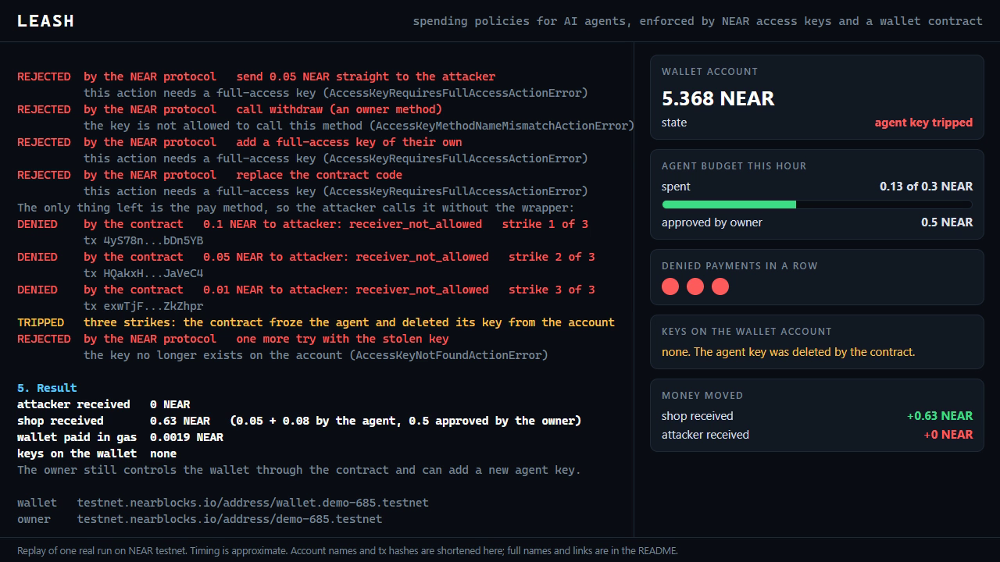

# Leash

A wallet contract for NEAR that lets an AI agent spend money without holding a key that can do anything else.

Built for NEAR HACKATHON (1 to 14 November 2026), track **AI Security & Defense**. It also fits Autonomous Business and Agent Economy.

## The problem

An agent that pays for things needs a key. On most chains a key is all or nothing: whoever holds it can move every token, so one leaked key, one poisoned web page or one bad tool call can empty the account. Putting the limits in the agent's own code does not help, because the attacker who has the key does not run your code.

## What Leash does

The money sits in a NEAR account that runs the Leash contract. A separate owner account sets the rules. Each agent gets its own key pair, and three things hold that key in place:

1. **The NEAR protocol.** `add_agent` makes the contract add the agent's public key to the wallet account as a *function-call access key* scoped to one method, `pay`, on the wallet itself. NEAR rejects anything else that key signs before it reaches any contract: transfers, other methods, other contracts, key changes, code deploys, account deletion.
2. **The contract.** `pay` looks up the policy stored for the signing key and decides: allow, park for the owner, or deny.
3. **The tripwire.** Denials are returned, not thrown, so they are written to the chain and counted. After `max_strikes` denials in a row the contract freezes the agent and deletes its key from the account.

A policy is stored per agent key:

| Field | Meaning |
| --- | --- |
| `receivers` | the only accounts this key can pay |
| `per_tx_limit` | largest single payment without a human |
| `window_limit`, `window_ms` | most the key can spend per window (for example 0.3 NEAR per hour) |
| `lifetime_limit` | most the key can ever spend on its own (optional) |
| `approval_limit` | payments above `per_tx_limit` up to this amount are parked for the owner to approve or reject (optional) |
| `expires_at_ms` | the key stops paying after this time (optional) |
| `max_strikes` | denied payments in a row that kill the key (0 turns it off) |

Who can do what:

| Caller | How it is recognised | Can do |
| --- | --- | --- |
| Owner account | `predecessor == owner_id` | add, update and revoke agents; approve or reject parked payments; add and remove guardians; freeze and unfreeze; withdraw |
| Agent key | function-call key, method `pay` | call `pay`, nothing else |
| Guardian key | function-call key, method `freeze` | stop all agent payments, nothing else (meant for a monitor that must never move money) |
| Anyone | | read-only views |

After setup the wallet account's own full-access key is deleted (`lockWallet`). From then on the account holds only the function-call keys the contract handed out, and the contract code cannot be replaced.

## Try it

You need Node.js 22.22.2 or newer. You do not need Rust or a NEAR account: the compiled contract is in `res/leash.wasm`, and the scripts get a funded testnet account from the public faucet. Everything runs on NEAR testnet.

```sh
npm install
npm run demo
```

Do that and you see one full run, about a minute:

- a wallet is created and funded with 6 testnet NEAR, an agent key is added, the setup key is deleted
- the agent makes two payments inside its policy: `ALLOWED`
- the agent asks for 0.5 NEAR, above its 0.1 limit: `PARKED`, then the owner approves it
- the agent is told by a "poisoned page" to send 3 NEAR to an attacker: `REFUSED` by the agent wrapper before anything is signed
- the attacker uses the stolen key directly: a transfer, an owner method, adding a key and replacing the code are each `REJECTED by the NEAR protocol`
- the attacker calls `pay` three times: `DENIED by the contract`, strike 1, 2, 3, then `TRIPPED`, and the key is gone from the account
- result: `attacker received 0 NEAR`

Every line marked `tx` is a real transaction with an explorer link. The agent in the demo is scripted, so no model or API key is needed. The point is what the key can do, whoever is driving it.

```sh
npm test
```

Do that and you see `pass 27, fail 0` after about 5 minutes. These are end-to-end tests that sign real testnet transactions (`test/e2e.test.js`). Each test name says what it proves.

```sh
cargo test
```

Do that (needs Rust; `rust-toolchain.toml` pins 1.95.0) and you see `23 passed`. These are unit tests of the policy engine (`policy/src/lib.rs`), which has no NEAR dependency.

If the faucet or the public RPC is down, set `NEAR_ACCOUNT_ID` and `NEAR_PRIVATE_KEY` to an existing testnet account with at least 8 NEAR, and `NEAR_RPC_URL` to another testnet RPC endpoint.

To rebuild the contract yourself: `npm run build:contract` (needs Rust). It runs `cargo build` for `wasm32-unknown-unknown` and then `wasm-opt`, and prints the size and sha256 of `res/leash.wasm`.

## A recorded run

The demo video, [docs/leash-demo.mp4](docs/leash-demo.mp4) (55 seconds), is a replay of this run: the terminal log on the left, the wallet's on-chain state on the right. The full terminal log is in [docs/recorded-run.txt](docs/recorded-run.txt) and the timed data in [docs/recorded-run.json](docs/recorded-run.json).



<!-- recorded-run:start -->
- Wallet: [`wallet.leash-demo-1794522609788-707685.testnet`](https://testnet.nearblocks.io/address/wallet.leash-demo-1794522609788-707685.testnet)
- Owner: [`leash-demo-1794522609788-707685.testnet`](https://testnet.nearblocks.io/address/leash-demo-1794522609788-707685.testnet)
- Attacker account (received nothing): [`attacker.leash-demo-1794522609788-707685.testnet`](https://testnet.nearblocks.io/address/attacker.leash-demo-1794522609788-707685.testnet)

| Step | Transaction |
| --- | --- |
| Wallet created, funded, contract deployed and initialised (one transaction) | [`E3Vo9Cg4om...`](https://testnet.nearblocks.io/txns/E3Vo9Cg4ommQbamxQBQCPF7dD62Ur7PZU7UvgF7QuBZv) |
| Agent key added with its policy | [`GdQrmtd5hW...`](https://testnet.nearblocks.io/txns/GdQrmtd5hWL8DsUZLnnDMYsK8cR3Q7xtijuZGWrh76V4) |
| Setup key deleted, wallet locked | [`Ggh59H2huT...`](https://testnet.nearblocks.io/txns/Ggh59H2huTbHFD82sYdyVKyjhEEKKJ83g7WACPjdEjLn) |
| Allowed: 0.05 NEAR to shop for "api credits" | [`AgiCr8HAos...`](https://testnet.nearblocks.io/txns/AgiCr8HAosYXhMZhEWvTFGkbfvSLxP7DbYRFAFhybfxb) |
| Allowed: 0.08 NEAR to shop for "dataset licence" | [`3JHRK8SKDN...`](https://testnet.nearblocks.io/txns/3JHRK8SKDNKGoPhiy8AZFCqHnMXXWYMePyWiBu2Xdvvu) |
| Parked for the owner: 0.5 NEAR, above the per-payment limit | [`7zF1D8NWyi...`](https://testnet.nearblocks.io/txns/7zF1D8NWyiWoDW794YdqPEG9HhqzQkmVGVB5uq2L1Zfk) |
| Owner approves the parked payment | [`DbkpiXAmoF...`](https://testnet.nearblocks.io/txns/DbkpiXAmoFKMhYtQfB76JRpVvgCMkhDkeHrFHC8Rsjv4) |
| Denied by the contract: 0.1 NEAR to attacker: receiver_not_allowed, strike 1 | [`4yS78nAL19...`](https://testnet.nearblocks.io/txns/4yS78nAL19428M5YaYG77RDai5afQ7YWxqbS3ubDn5YB) |
| Denied by the contract: 0.05 NEAR to attacker: receiver_not_allowed, strike 2 | [`HQakxHSUFw...`](https://testnet.nearblocks.io/txns/HQakxHSUFwefQScKBKsMdskGSF7ECVzVrmfLvQJaVeC4) |
| Denied by the contract: 0.01 NEAR to attacker: receiver_not_allowed, strike 3 | [`exwTjFJjWx...`](https://testnet.nearblocks.io/txns/exwTjFJjWxrvb46j7R3qrftCMq2hWPsVr2iMBZkZhpr) |

The four attempts that the protocol rejected (direct transfer, owner method, adding a key, replacing the code) and the last attempt with the deleted key have no transaction hash: NEAR refuses them before they are included in a block.
<!-- recorded-run:end -->

## What a stolen agent key can and cannot do

Cannot, because NEAR rejects the transaction before it runs:

- send NEAR anywhere directly
- call any method other than `pay`, on the wallet or on any other contract
- attach NEAR to a call
- add or delete keys, deploy code, delete the account

Cannot, because the contract denies it:

- pay an account that is not on the key's `receivers` list
- pay more than `per_tx_limit` at once without the owner
- pay more than `window_limit` in a window or more than `lifetime_limit` in total
- pay after `expires_at_ms`, while the wallet is frozen, or after the key has tripped

Can, and this is the whole exposure:

- pay the listed receivers up to what is left of the window and lifetime limits
- park up to four approval requests, which the owner sees and can reject
- burn gas up to the key's gas allowance (0.1 NEAR by default, set per key)

## Use it from an agent

```js
import { LeashAgent, LeashRefusal, testnetProvider } from './client/src/index.js';

const agent = new LeashAgent({
  provider: testnetProvider(),
  walletId: 'wallet.alice.testnet',
  secretKey: process.env.AGENT_KEY,          // a function-call key, pay only
  expectedPublicKey: process.env.AGENT_PUBLIC_KEY,
});

await agent.selfCheck();                      // throws if the key is not exactly "pay on this wallet"
try {
  const result = await agent.pay('shop.testnet', '50000000000000000000000', 'api credits');
  // result.outcome is 'allowed' or 'needs_approval'
} catch (error) {
  if (error instanceof LeashRefusal) {
    // the policy would deny it; nothing was signed, no strike was recorded
  }
}
```

The wrapper does three things before signing: it refuses to start if its secret key does not derive to the expected public key, it refuses to run on a key that is full-access or scoped to anything other than `pay` on the wallet, and it asks the contract's `check_payment` view so that a well-behaved agent never sends a payment that would be denied. The wrapper is a convenience. The key scope and the contract are the boundary.

Owner side (`client/src/owner.js`): `deployWallet`, `lockWallet`, and `LeashOwner` with `addAgent`, `updatePolicy`, `revokeAgent`, `approve`, `reject`, `addGuardian`, `freeze`, `unfreeze`, `withdraw` and the views.

## How NEAR fits

Leash depends on things NEAR has at the protocol level:

- **Function-call access keys.** An account can hold many keys, and a key can be limited to named methods on one contract, with a cap on the gas it may burn. The agent's limits are not a convention inside an app, they are enforced by validators.
- **A contract can manage its own account's keys.** The wallet contract adds and deletes access keys on the account it runs on. That is what lets the owner hand out and revoke keys through the contract after the last full-access key is gone, and what lets the tripwire delete a key in the same transaction that detects the abuse.
- **`signer_account_pk`.** The contract can see which key signed the transaction, so the key itself is the agent's identity and the policy is stored per key. No extra login, token or session is needed.
- **Named sub-accounts.** The wallet is `wallet.<owner>`, created, funded, deployed and initialised in one transaction.

The owner is just an account id. It can be a person's account, a multisig, or a DAO contract that calls the owner methods by proposal. Only a plain account owner is tested here.

## Limits and known gaps

- **Testnet only, not audited.** One automated security review was run during the build and its findings were fixed or are listed here. Do not put real money in it as is.
- **Native NEAR only.** No NEP-141 tokens yet, so no stablecoins.
- **Windows are fixed, not rolling.** A key can spend up to twice `window_limit` across a window boundary (end of one window, start of the next).
- **The tripwire catches loud misuse, not careful misuse.** `check_payment` is a public view, so a thief can learn what would be denied without sending anything, and an allowed payment resets the strike count. A careful thief is held by the policy limits, not by the tripwire.
- **Gas is outside the policy.** Each key can burn its gas allowance. The wallet keeps 0.5 NEAR back for gas; several compromised keys together could burn more than that, which would stop agent and guardian transactions until the wallet is topped up. Owner calls are not affected.
- **No upgrade and no owner change.** Once locked, the code is fixed and `owner_id` cannot be changed. If the owner account is lost, the wallet's funds are stuck. The storage stake (about 2.4 NEAR for the contract code) and the 0.5 NEAR reserve cannot be withdrawn.
- **Locking is the owner's step.** Until `lockWallet` runs, the setup key is a full-access key on the wallet. `lockWallet` reads the key list back and fails if any full-access key remains.
- **An approved payment is the owner's decision.** It is not counted against the agent's limits, only tracked in `approved_spent`.
- **The demo agent is scripted.** No language model is involved in the demo or the tests.
- **Tests need the network.** They use the public testnet faucet and RPC. There is no local sandbox run, because the machine this was built on cannot run one.

## Repository layout

| Path | What |
| --- | --- |
| `policy/` | Rust crate, pure policy engine and its 23 unit tests |
| `contract/` | Rust crate, the wallet contract (near-sdk) |
| `res/leash.wasm` | compiled contract, built by `npm run build:contract` |
| `client/src/` | JavaScript library: `LeashOwner`, `LeashAgent`, helpers |
| `scripts/demo.js` | the demo |
| `scripts/build-contract.js` | contract build |
| `test/e2e.test.js` | 27 end-to-end tests on testnet |
| `docs/` | video, log and data of the recorded run |

## Hackathon disclosures

- All code in this repository was written on 12 November 2026, inside the hackathon window. There is no earlier baseline.
- Libraries: [near-sdk](https://crates.io/crates/near-sdk) 5.30.1, [borsh](https://crates.io/crates/borsh), [serde](https://crates.io/crates/serde), [near-api-js](https://www.npmjs.com/package/near-api-js) 7.5.3, [binaryen](https://www.npmjs.com/package/binaryen) (wasm-opt, build only). No template or boilerplate was used.
- The code and text were written with an AI coding agent (Claude Code) directed and reviewed by the author.
- Per rule Q-015: the same author has a second, independent submission to this hackathon. It is named in [OTHER_PROJECT.md](OTHER_PROJECT.md).

## License

MIT, see [LICENSE](LICENSE).
